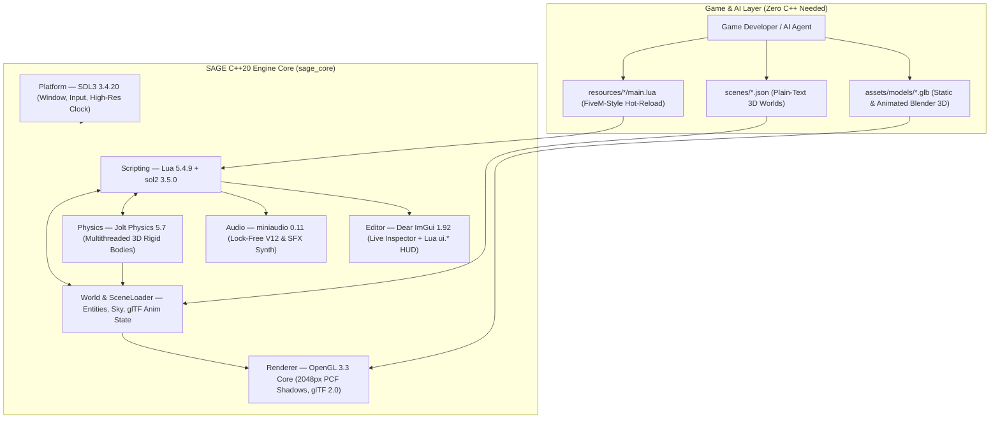

# SAGE Engine Architecture

SAGE cleanly separates **high-performance native C++20 systems** from **AI- and developer-friendly game creation (JSON + Lua + Blender `.glb`)**.

---

## C++ Subsystem Map (`engine/`)

Every engine subsystem lives behind a clean, dependency-free public header under `engine/include/sage/` so third-party libraries (`SDL3`, `OpenGL`, `Jolt`, `sol2`, `miniaudio`, `Dear ImGui`, `cgltf`) stay encapsulated inside `.cpp` files:

| Subsystem | Public Header | Implementation | Responsibility |
| :--- | :--- | :--- | :--- |
| **Core Loop** | [`engine/include/sage/engine.h`](../engine/include/sage/engine.h) | [`engine/src/engine.cpp`](../engine/src/engine.cpp) | Fixed `60 Hz` accumulator tick, hot-reload polling, Free-Fly 3D camera, subsystem orchestration |
| **Platform** | [`platform/window.h`](../engine/include/sage/platform/window.h), [`platform/input.h`](../engine/include/sage/platform/input.h) | [`window.cpp`](../engine/src/platform/window.cpp), [`input.cpp`](../engine/src/platform/input.cpp) | SDL3 window, OpenGL 3.3 Core context, OS events, keyboard/mouse state |
| **World & Scenes** | [`world/world.h`](../engine/include/sage/world/world.h), [`world/scene_loader.h`](../engine/include/sage/world/scene_loader.h) | [`world.cpp`](../engine/src/world/world.cpp), [`scene_loader.cpp`](../engine/src/world/scene_loader.cpp) | 3D entity registry with generational `EntityHandle`s and `ComponentStore` components (look-at, ragdoll), Euler & quaternion transforms, glTF animation playback, procedural sky/time-of-day, JSON scene parser |
| **3D Renderer** | [`renderer/renderer.h`](../engine/include/sage/renderer/renderer.h) | [`gl_renderer.cpp`](../engine/src/renderer/gl_renderer.cpp) (passes), [`gl_model.cpp`](../engine/src/renderer/gl_model.cpp) (meshes/models), [`gl_animation.cpp`](../engine/src/renderer/gl_animation.cpp) (glTF animation, IK, ragdoll layer), [`gl_shaders.cpp`](../engine/src/renderer/gl_shaders.cpp) (shader loading + hot reload), [`gl_profiler.h`](../engine/src/renderer/gl_profiler.h), [`gl_functions.cpp`](../engine/src/renderer/gl_functions.cpp); GLSL in [`engine/shaders/`](../engine/shaders/) | Backend-agnostic interface; OpenGL 3.3 implementation with 3-cascade PCF shadows, sky dome, GGX PBR shading, clustered point lights, ACES tone mapping, `cgltf` + `stb_image` `.glb` loader |
| **Physics** | [`physics/physics_world.h`](../engine/include/sage/physics/physics_world.h) | [`physics_world.cpp`](../engine/src/physics/physics_world.cpp) | Multithreaded Jolt Physics 5.7 rigid bodies (static/dynamic/kinematic boxes, spheres, capsules, convex-hull ramps), explosions, raycasts |
| **Audio** | [`audio/audio_engine.h`](../engine/include/sage/audio/audio_engine.h) | [`audio_engine.cpp`](../engine/src/audio/audio_engine.cpp) | Lock-free `miniaudio` 48 kHz stereo audio thread with V12 harmonic engine synth, drift screech, nitro roar, impacts, chimes, and shockwave booms |
| **Editor & UI** | [`editor/editor_ui.h`](../engine/include/sage/editor/editor_ui.h) | [`editor_ui.cpp`](../engine/src/editor/editor_ui.cpp) | Dear ImGui 1.92 SDL3 + OpenGL 3.3 live inspector (`F1`) + host frame for Lua `onRenderUI()` custom game HUDs |
| **Scripting** | [`scripting/lua_engine.h`](../engine/include/sage/scripting/lua_engine.h) | [`lua_engine.cpp`](../engine/src/scripting/lua_engine.cpp) | FiveM-style `resources/*/manifest.json` loader, isolated `sol::environment` per resource, crash-proof protected calls, automatic file-watch hot-reload |

---

## Core Design Principles

1. **Table Tennis Rule (Start Focused, Scale Like RAGE):** Prove every system in a playable 3D showcase before scaling to streaming open worlds.
2. **Hot-Reload Everything:** Save `.lua` scripts, `scenes/*.json` or `engine/shaders/*.vert|*.frag` and see changes live without rebuilding C++. A shader with an error keeps the last working version running.
3. **Zero Silent Magic:** Missing `.glb` files, malformed JSON, shader compiler errors, or Lua runtime errors log exact file paths and line numbers without crashing the editor window.
4. **Backend-Ready Interfaces:** Renderer, platform, physics, and audio sit behind clean C++ interfaces so OpenGL can evolve to Vulkan/DX12 without breaking a single Lua script.
