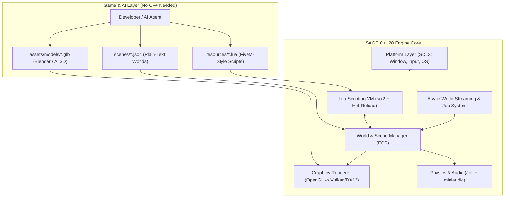

# SAGE Engine Architecture

SAGE separates **fast native systems (C++20)** from **AI- and human-friendly game creation (JSON + Lua + glTF)**.

## Design Philosophy
1. **Start simple, scale like RAGE:** Begin with a clean sandbox renderer and upgrade toward Deferred PBR, Cascaded Shadow Maps, and open-world chunk streaming.
2. **Hot-reload everything:** Editing `.lua` scripts or `.json` scenes reloads live without rebuilding C++.
3. **Self-documenting for AI:** Every engine capability is documented in `docs/lua_api.md` and `AGENTS.md`.
